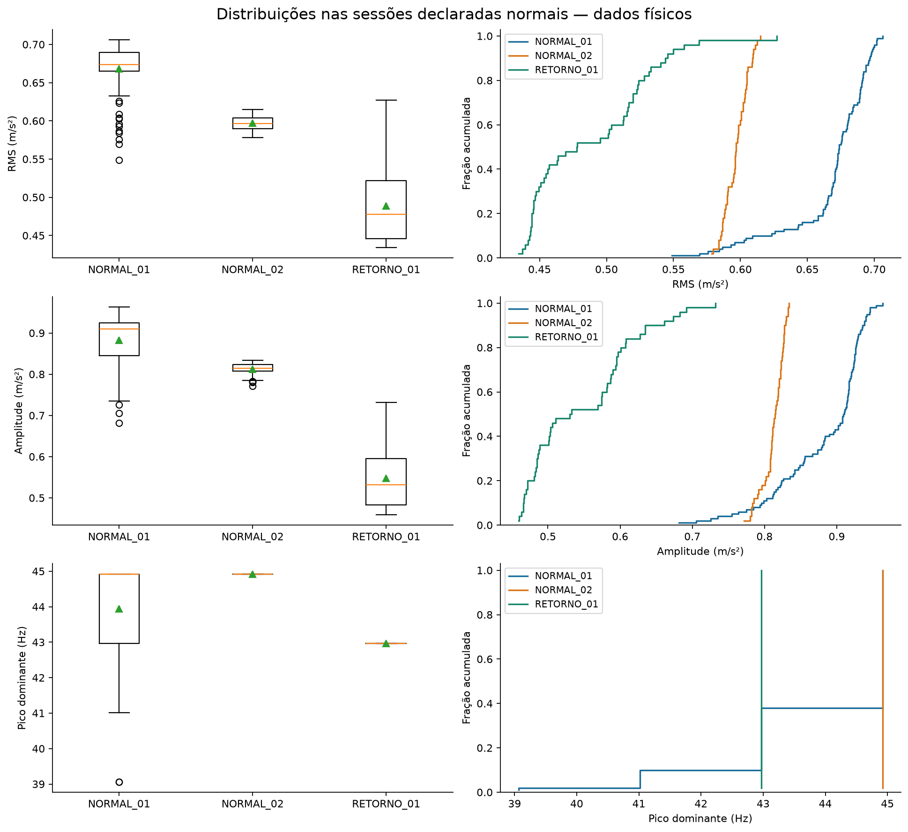
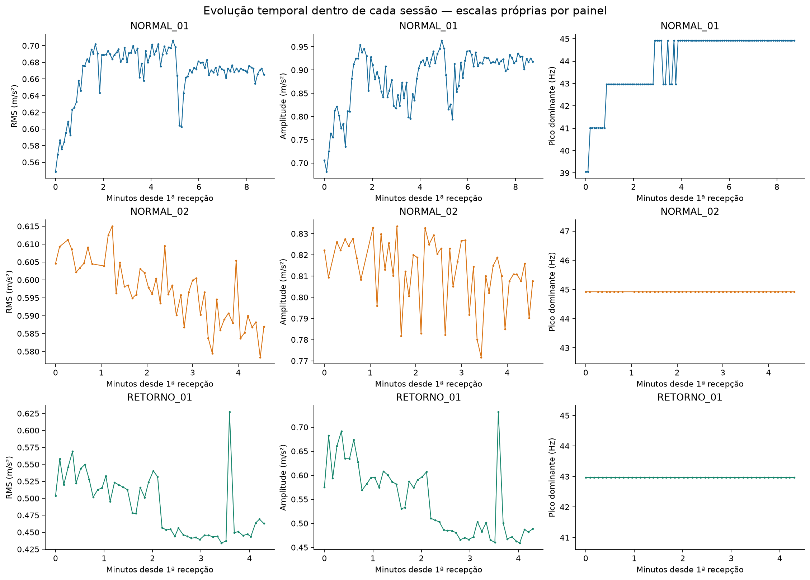
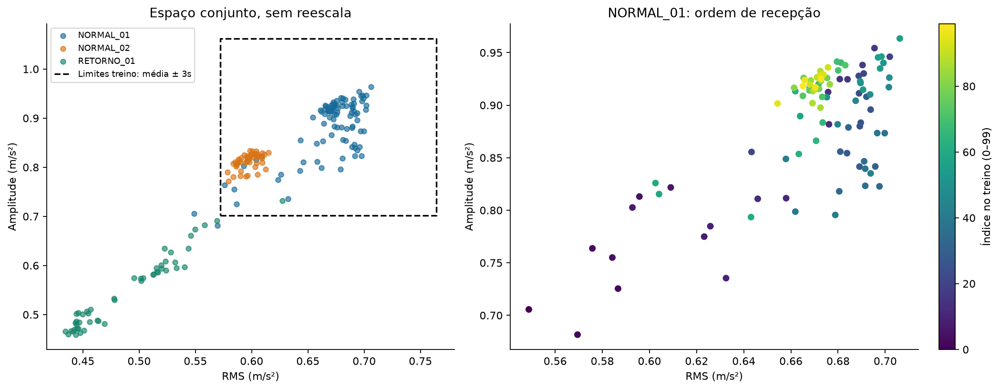
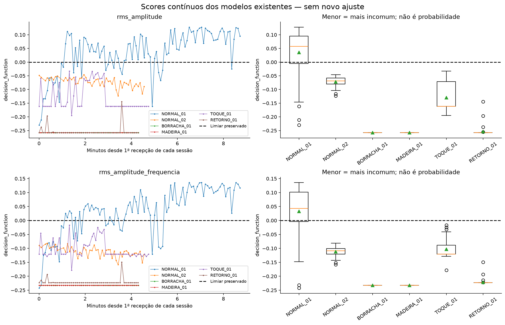

# Diagnóstico do Machine Learning — campanha física de 10/11/2026

## Conclusão técnica

**O problema observado está principalmente na representatividade dos dados de treinamento e na generalização da referência entre sessões, com contribuição da fronteira/limiar atual do Isolation Forest. Não foi encontrado erro na implementação dos scores ou do pré-processamento auditados.**

Há deslocamentos sistemáticos nas medições das sessões declaradas normais. NORMAL_02 ocupa uma região pouco representada da NORMAL_01, embora esteja dentro de seus limites marginais mínimo–máximo. RETORNO_01 apresenta RMS e amplitude muito abaixo da maior parte do treinamento. A própria NORMAL_01 inclui evolução temporal importante; os 30 segundos de espera utilizados não demonstraram estacionariedade da referência.

Isso **não identifica a causa física** dos deslocamentos, não comprova defeito do ventilador e não permite concluir que aumentar apenas o número de pontos resolveria o problema. Há uma única campanha, um equipamento, ordem fixa e nenhuma medição independente de rotação, tensão sob carga, temperatura ou reprodutibilidade da montagem.

Não foram recalibrados os modelos, `contamination`, `offset_` ou seus limiares. NORMAL_02 e RETORNO_01 não foram usadas para ajustar parâmetros. O baseline estatístico desta investigação é um comparador separado; não substitui os modelos existentes. Como já observamos os resultados destas sessões, qualquer nova escolha de método ou limiar precisará de **novas sessões intocadas de validação**.

## Escopo, preservação e evidências

Investigação sobre os 355 registros reais associados às seis sessões encerradas, incluindo 100 de NORMAL_01, 50 de NORMAL_02 e 50 de RETORNO_01. Os demais 155 pertencem às mudanças experimentais, sem rótulos de falhas mecânicas. Não foram usados registros históricos sem condição conhecida.

Comparação original: `c2d8ab9b-60df-446c-9a56-f70765c13d74`.

| Variante | Modelo original |
|---|---|
| RMS + amplitude | `45a754e8-284d-445c-aafc-8db76e312a95` |
| RMS + amplitude + frequência | `03691e35-986a-40c5-908c-d200b14a5295` |

Antes da investigação foi criado um snapshot consistente do SQLite e foram copiadas as evidências e fontes originais para uma pasta privada ignorada em `.marco3_local/`. A análise abre esse snapshot em modo somente leitura. Nenhum modelo ou score foi gravado no banco durante o diagnóstico. Os artefatos originais continuam armazenados no SQLite, com seus hashes, 200 vínculos de treinamento e 710 scores.

- [Auditoria numérica completa, scores por ID e baseline](evidencias_ml/diagnostico/auditoria.json).
- [Verificação final de preservação](evidencias_ml/diagnostico/preservacao.json).
- [Avaliação física original preservada](evidencias_ml/avaliacao_fisica.json).
- Evidências individuais `coleta_NORMAL_01.json`, `coleta_NORMAL_02.json` e `coleta_RETORNO_01.json` em `docs/evidencias_ml/`, incluindo condições confirmadas pelo operador, horários e vínculos originais.

## Auditoria do pipeline

Foram verificados numericamente 49 itens por modelo, incluindo a reprodução do relatório original: todos aprovados. O erro máximo absoluto dos scores recalculados contra o SQLite foi **0,0** nos 710 pontos deste ambiente.

| Item | Verificação e resultado |
|---|---|
| Ordem das features | `[rms, amplitude]` e `[rms, amplitude, pico_fft]`, respectivamente, no ajuste e na avaliação. As matrizes são construídas pelo nome na ordem persistida, não pela ordem das colunas retornadas pelo SQLite. |
| Unidades | RMS AC e amplitude de pico em m/s²; frequência dominante em Hz. RMS e amplitude não são a mesma grandeza. Não há conversão adicional no caminho ML. |
| Valores ausentes/inválidos | Nos 355 registros elegíveis: três features presentes, finitas e não negativas; atrasos=0. O protocolo exclui registros inadequados e preserva o motivo. Não há preenchimento por zero, imputação ou descarte silencioso na auditoria. |
| Treinamento | Os mesmos 100 IDs 275–374, exclusivamente NORMAL_01. Vínculos SQL e hash do snapshot de treinamento conferidos. |
| Scaler | `StandardScaler`, média e variância populacional (`ddof=0`) reproduzidas somente com NORMAL_01; `n_samples_seen_=100`. Nenhum `fit` na avaliação. |
| Carregamento | Hash do pickle verificado antes da desserialização; versão sklearn compatível; pipeline carregado diretamente do artefato local confiável. Não carregar pickle externo. |
| Aplicação da escala | Score do pipeline completo igual ao da floresta sobre `scaler.transform(X)`; não há dupla normalização. |
| Floresta | 200 árvores, `random_state=42`, `n_jobs=1`, `max_samples='auto'`; efetivamente 100 amostras por árvore nesta referência. |
| Fontes | Hashes dos três fontes registrados no treinamento continuam iguais: `analytics/isolation.py`, `backend/experiments.py` e `backend/experiment_schema.py`. |
| Persistência | Recalculados `score_samples`, `decision_function` e `predict`; comparados com scores/alertas do SQLite e relatório original para cada modelo, sessão e ID. |

Os parâmetros do scaler carregado foram:

| Feature | Média no treino | Escala do scaler |
|---|---:|---:|
| RMS | 0,66812381 | 0,03177866 |
| Amplitude | 0,88201695 | 0,05977086 |
| Frequência, somente variante com 3 features | 43,94531250 | 1,42189646 |

Variância zero da frequência **dentro das sessões de avaliação** não causa erro: o scaler mantém a escala aprendida no treino, onde a frequência varia. O uso de m/s² e Hz não produz dominância numérica por falta de escala neste pipeline. A escala linear, por si só, também não torna a referência representativa de outras condições operacionais.

### Semântica das funções e do limiar

Na versão instalada, scikit-learn 1.9.1, conferida também pelo fonte local:

```text
decision_function(X) = score_samples(X) - offset_
offset_ = -0.5, pois contamination = 'auto'
predict(X) = -1 se decision_function(X) < 0; caso contrário +1
```

Essa relação foi conferida em todos os registros. Menor score significa observação mais incomum para aquela floresta; não é probabilidade nem gravidade física. `contamination='auto'` não exige taxa fixa de alertas e não garante baixa taxa de falsos alertas em dados normais. A taxa de 26% no treino é uma observação desta referência, não uma porcentagem configurada. A implementação segue a [documentação oficial de IsolationForest](https://scikit-learn.org/stable/modules/generated/sklearn.ensemble.IsolationForest.html). O cálculo do scaler está de acordo com a [documentação de StandardScaler](https://scikit-learn.org/stable/modules/generated/sklearn.preprocessing.StandardScaler.html).

O erro de threads SQLite ocorrido no início de NORMAL_02 foi corrigido na coleta e não altera a álgebra dos scores. Houve lacuna de recepção de até 15,770 s nessa sessão; isso deve acompanhar a análise temporal. Não foram recuperadas nem fabricadas janelas perdidas. Esta auditoria não valida a calibração do sensor, a frequência efetiva de amostragem ou a condição mecânica.

## Estatísticas das sessões normais

Desvio padrão **amostral**, `ddof=1`; por isso difere ligeiramente da escala do StandardScaler. Valores arredondados abaixo; quantis 5%, 25%, 75% e 95% também estão no JSON da auditoria.

| Sessão | Variável | N | Média | Desvio padrão | Mediana | Mínimo | Máximo |
|---|---|---:|---:|---:|---:|---:|---:|
| NORMAL_01 | RMS (m/s²) | 100 | 0,668124 | 0,031939 | 0,673683 | 0,548809 | 0,706167 |
| NORMAL_02 | RMS (m/s²) | 50 | 0,596926 | 0,008909 | 0,596594 | 0,578367 | 0,614995 |
| RETORNO_01 | RMS (m/s²) | 50 | 0,488572 | 0,044933 | 0,477989 | 0,434243 | 0,627190 |
| NORMAL_01 | Amplitude (m/s²) | 100 | 0,882017 | 0,060072 | 0,909502 | 0,681603 | 0,963457 |
| NORMAL_02 | Amplitude (m/s²) | 50 | 0,812088 | 0,015552 | 0,814619 | 0,771702 | 0,833508 |
| RETORNO_01 | Amplitude (m/s²) | 50 | 0,547658 | 0,073125 | 0,531659 | 0,459203 | 0,731652 |
| NORMAL_01 | Frequência (Hz) | 100 | 43,945313 | 1,429060 | 44,921875 | 39,062500 | 44,921875 |
| NORMAL_02 | Frequência (Hz) | 50 | 44,921875 | 0 | 44,921875 | 44,921875 | 44,921875 |
| RETORNO_01 | Frequência (Hz) | 50 | 42,968750 | 0 | 42,968750 | 42,968750 | 42,968750 |

### Distribuições e deslocamentos



Os pontos fora dos bigodes do boxplot são apenas a convenção gráfica de quartis; não são os alertas do modelo.

| Comparação com NORMAL_01 | Variável | Variação da mediana | Diferença das médias / desvio do treino | Distância KS empírica | Registros fora de mínimo–máximo do treino |
|---|---|---:|---:|---:|---:|
| NORMAL_02 | RMS | −11,44% | −2,23 | 0,90 | 0/50 |
| NORMAL_02 | Amplitude | −10,43% | −1,16 | 0,79 | 0/50 |
| NORMAL_02 | Frequência | 0% | +0,68 | 0,38 | 0/50 |
| RETORNO_01 | RMS | −29,05% | −5,62 | 0,97 | 46/50 |
| RETORNO_01 | Amplitude | −41,54% | −5,57 | 0,97 | 47/50 |
| RETORNO_01 | Frequência | −4,35% | −0,68 | 0,62 | 0/50 |

KS está sendo usado como distância entre distribuições empíricas, **sem p-valor ou alegação de significância baseada em amostras independentes**. A distância de Wasserstein também foi calculada no JSON, nas unidades de cada variável. Por exemplo, RMS: 0,072040 m/s² na NORMAL_02 e 0,179552 m/s² no retorno.

NORMAL_02 está dentro da faixa total do treino, mas quase toda abaixo do seu núcleo de RMS. Estar dentro do intervalo mínimo–máximo não significa ter densidade ou distribuição conjunta semelhante. O retorno, por sua vez, está majoritariamente fora até desse intervalo marginal. Isso evidencia deslocamento das features medidas entre sessões declaradas normais, não sua causa mecânica.

### Evolução dentro das sessões



Os painéis têm escalas próprias e mostram minutos a partir da primeira recepção de cada sessão, não um relógio contínuo da aquisição. Há variação temporal que uma tabela de médias esconderia:

| Sessão | RMS: média dos primeiros → últimos 20 | Amplitude: média dos primeiros → últimos 20 |
|---|---:|---:|
| NORMAL_01 | 0,632603 → 0,669625 | 0,823426 → 0,919279 |
| NORMAL_02 | 0,604116 → 0,589978 | 0,817083 → 0,806004 |
| RETORNO_01 | 0,521350 → 0,456159 | 0,606515 → 0,490276 |

Na NORMAL_01, a frequência ocupa quatro bins: 39,0625 Hz (2 registros), 41,015625 Hz (8), 42,96875 Hz (28) e 44,921875 Hz (62), com concentração nos bins maiores mais adiante. A sequência de RMS também apresenta subida inicial e outras variações; não é uma deriva linear simples. Ambos os modelos alertam em 15 dos primeiros 20 registros do próprio treino, contra 1/20 no fim para 2 features e 0/20 para 3 features.

A autocorrelação de primeira defasagem do RMS da NORMAL_01 é 0,875. Cem registros contíguos não equivalem a cem ensaios independentes. Não foi estimado um tamanho amostral efetivo, pois a não estacionariedade compromete uma correção simples por AR(1).

A hipótese de estabilização insuficiente é compatível com esses dados, mas permanece hipótese: não houve instrumento independente para verificar rotação, aquecimento, alimentação ou montagem durante cada janela. Os picos de NORMAL_02 e retorno diferem exatamente um bin de FFT, 1,953125 Hz; isso não estabelece mudança proporcional de RPM.



O grupo da NORMAL_02 se separa do núcleo denso do treinamento; os valores menores de treino pertencem em grande parte a seu trecho inicial. Uma referência que mistura transição e regime posterior pode tratar uma nova operação normal como região incomum. Essa interpretação é descritiva e não autoriza retirar retroativamente o início do treino para melhorar a taxa.

## Scores contínuos e análise de cada modelo



| Sessão | RMS + amplitude: mínimo / mediana / máximo | + frequência: mínimo / mediana / máximo |
|---|---|---|
| NORMAL_01 | −0,229806 / +0,057265 / +0,127970 | −0,242111 / +0,042915 / +0,136204 |
| NORMAL_02 | −0,123653 / −0,068790 / −0,045518 | −0,158064 / −0,108889 / −0,081849 |
| RETORNO_01 | −0,257848 / −0,257848 / −0,144174 | −0,223228 / −0,223228 / −0,149277 |

**RMS + amplitude:** todos os scores da NORMAL_02 ficam abaixo de zero, embora a margem seja menor que a do retorno. Na NORMAL_02, as médias transformadas são aproximadamente −2,24 escalas de treino no RMS e −1,17 na amplitude. No retorno, são −5,65 e −5,59 escalas. A floresta está reagindo a regiões diferentes da referência, não a inversão do sinal de `predict`.

**RMS + amplitude + frequência:** mantém 100% de alertas nas duas sessões. A frequência de NORMAL_02 é o próprio bin mais frequente no treino, e a do retorno é um bin já observado nele; portanto a frequência isolada não explica os alertas. A dimensão adicional muda a geometria e os scores, mas não corrige a representatividade do treinamento. As médias transformadas da frequência são +0,687 na NORMAL_02 e −0,687 no retorno.

Scores entre variantes não são probabilidades calibradas numa escala comum. Uma margem mais negativa em um modelo não prova, sozinha, maior gravidade ou melhor detector. A correlação entre os scores das duas variantes é 0,952 no treino, 0,728 na NORMAL_02 e 0,993 no retorno; taxas iguais não significam scores iguais.

Há saturação: **46/50 registros do retorno têm exatamente o mesmo score em cada modelo**; borracha e madeira têm scores constantes em suas 50 observações, iguais entre essas duas sessões dentro de cada modelo. Árvores encaminham diferentes pontos externos pelas mesmas folhas; não extrapolam uma escala contínua de distância física. Isso é compatível com a implementação da floresta e limita a interpretação de intensidade do desvio.

## Baseline estatístico independente

Foi declarada uma regra simples, bilateral e fixa: alerta se RMS **ou** amplitude estiver fora de `média ± 3 × desvio padrão amostral`, ajustados somente aos 100 registros de NORMAL_01. O limite inferior é truncado em zero por serem grandezas não negativas; nesta campanha isso não altera os limites. Não foi feita busca por multiplicadores nem comparação de candidatos para escolher o melhor na validação.

| Feature | Limite inferior | Limite superior |
|---|---:|---:|
| RMS (m/s²) | 0,572308 | 0,763940 |
| Amplitude (m/s²) | 0,701801 | 1,062233 |

Margem contínua do baseline: `3 − max(abs((feature − média_treino)/s_treino))`; valor negativo indica alerta. Essa margem também não é probabilidade nem deve ser comparada numericamente à escala do IF. Todos os seus valores e IDs de treinamento estão na auditoria.

| Sessão | N | IF RMS + amplitude | IF + frequência | Baseline estatístico |
|---|---:|---:|---:|---:|
| NORMAL_01 — treino | 100 | 26/100 (26%) | 26/100 (26%) | 2/100 (2%) |
| NORMAL_02 — validação | 50 | 50/50 (100%) | 50/50 (100%) | 0/50 (0%) |
| BORRACHA_01 — apoio alterado | 50 | 50/50 (100%) | 50/50 (100%) | 50/50 (100%) |
| MADEIRA_01 — apoio alterado | 50 | 50/50 (100%) | 50/50 (100%) | 50/50 (100%) |
| TOQUE_01 — sessão mista | 55 | 55/55 (100%) | 55/55 (100%) | 51/55 (92,73%) |
| RETORNO_01 — validação | 50 | 50/50 (100%) | 50/50 (100%) | 49/50 (98%) |

O baseline não alerta na NORMAL_02, mostrando que uma fronteira marginal mais larga tolera esse deslocamento. Porém também falha no retorno: o problema não desaparece apenas substituindo IF por limites simples. A taxa observada de 0% em uma sessão não certifica ausência de falsos alertas futuros. A regra 3s não possui garantia nominal gaussiana/IID nestes dados.

TOQUE_01 mistura antes, durante e depois de uma única sequência não instrumentada; sua taxa global não é sensibilidade a toques. No IF, já havia 10/10 alertas antes, 12/12 durante e 11/11 depois nas janelas aproximadas. Não há contraste de classificação que atribua esses alertas à perturbação. Os marcadores têm incerteza humana/chat não medida; janelas transmitidas de 0,512 s aproximadamente a cada 5 s podem perder contatos individuais.

## O que os dados permitem decidir

| Hipótese | Evidência | Conclusão permitida |
|---|---|---|
| Erro de implementação dos scores | Reprodução exata, escala/ordem/artefato/IDs/álgebra conferidos | Não encontrado no caminho auditado. Não equivale a calibração metrológica do hardware. |
| Mudança na distribuição medida | Distâncias empíricas elevadas e deslocamentos de RMS/amplitude, inclusive entre sessões normais | Demonstrada nesta campanha. Causa física específica não identificada. |
| Fronteira/limiar restritivo | 26% de alertas no treino; NORMAL_02 100% no IF versus 0% na regra 3s | Contribui para baixa especificidade. Não autoriza escolher novo offset com estes holdouts. |
| Referência insuficientemente representativa | Uma sessão temporalmente dependente, evolução durante o treino e retorno muito deslocado | Principal limitação sustentada pelos dados; falha de generalização entre sessões. |
| Poucos dados em número absoluto | Somente 100 pontos de uma sessão | Não é possível isolar o efeito de N. Mais pontos do mesmo trecho estável podem não cobrir variabilidade entre partidas/montagens. |
| Desbalanceamento, desalinhamento ou defeito mecânico | Sem RPM real, instrumento de referência ou ensaio controlado de defeitos | Não demonstrado. Não usar os alertas como diagnóstico de falha. |

## Próximo experimento recomendado

**Investigar primeiro a repetibilidade normal e a estabilização; não começar procurando um hiperparâmetro que aprove os holdouts atuais.** Não iniciar automaticamente novas sessões com a fonte ou condição física desconhecida. Este é um protocolo proposto; nenhuma dessas novas coletas foi realizada.

1. **Repetição sem mudar a montagem:** três partidas normais independentes, sem retirar o sensor ou mudar apoio entre elas. Antes de cada partida, manter ventilador desligado por cinco minutos e anotar esse intervalo; isso padroniza a pausa, mas não garante equilíbrio térmico. Manter ESP32 no USB. Fotografar/marcar a posição original, registrar apoio, fixação, eixo, fonte e eventuais ajustes.
2. **Estabilização observada:** em cada partida, acompanhar dez minutos de aquecimento, registrando o instante de ligar. Esse prazo é uma escolha nova, pré-declarada, não garantia de estabilização. Conservar dados e metadados desse período em uma fase própria, sem misturá-los automaticamente ao treino de regime. Depois coletar **100 registros válidos sem toques**, aproximadamente nove minutos. Estimativa: cerca de uma hora de ventilador ligado para as três partidas, além das pausas.
3. **Critério descritivo previamente registrado:** comparar RMS e amplitude dos primeiros e últimos 20 registros após o aquecimento, além das séries temporais e bins dominantes. Usar diferença relativa de médias de até 5% em cada grandeza como critério operacional proposto de estabilidade; manter a frequência modal dentro de um bin. Esse critério não é diagnóstico nem teste de significância. Se não atendido, registrar “regime ainda não estável”; não apagar dados, mudar o corte até passar ou selecionar apenas trechos favoráveis. Planejar outra rodada com aquecimento maior antes de coletá-la.
4. **Avaliar os modelos atuais congelados** nas três repetições e comparar distribuições/scores por sessão. Não reajustar o scaler, o limiar ou os modelos com esses dados durante a coleta. Registrar a tensão da fonte sob carga e temperatura ambiente se houver instrumentos adequados; se não houver, declarar indisponíveis. Manter TACH desconectado até validação elétrica.
5. **Separar o efeito da remontagem:** somente depois, repetir uma partida com retirada e restauração documentada do apoio original, sem mudar a fixação do sensor. Se a variabilidade aparecer principalmente após remontagem, priorizar um procedimento mecânico reprodutível. Se persistir sem tocar na montagem, investigar alimentação, estabilização operacional e resposta de medição antes de alterar o detector. Medir velocidade por instrumento externo adequado, se disponível; não inferir RPM do pico FFT.
6. **Se for necessário novo modelo:** criar versão de protocolo/modelo separada, com sessões novas explicitamente destinadas a treino, calibração e validação final, separadas por partida e preferencialmente por dia. A infraestrutura atual exige exatamente NORMAL_01 com 100 registros por modelo; treino com várias sessões exigirá alteração explícita e testada dessa regra em uma etapa futura. Não contornar a proteção SQL, concatenar holdouts antigos ou renomear NORMAL_02/RETORNO_01. O modelo e relatório atuais permanecem como referência histórica.

As fases de aquecimento e os novos códigos/contagens devem ser definidos antes da próxima campanha, com suporte de metadados no coletor; a auditoria não criou sessões novas nem alterou a API para isso. Depois de demonstrar repetibilidade normal, planejar comparação de apoios com réplicas e ordem alternada, evitando confundir tempo de funcionamento com condição experimental. Para transientes individuais, será necessário outro protocolo de aquisição/transmissão e marcação de eventos; esta investigação não mudou o firmware.

## Reprodutibilidade e validação de software

Novos arquivos: `analytics/diagnostics.py`, `scripts/diagnosticar_ml.py`, `tests/test_diagnostico_ml.py` e `requirements-diagnostico.txt`. O script exige snapshot local confiável e pasta de saída nova; não chama `fit` do IF, não altera o banco e não sobrescreve o relatório original.

```powershell
# Na raiz monitoramento_ventilador:
.\.venv\Scripts\python.exe -m pip install -r requirements-diagnostico.txt
.\.venv\Scripts\python.exe scripts/diagnosticar_ml.py --snapshot <snapshot-local-confiavel.db> --saida <nova-pasta-de-resultados>
.\.venv\Scripts\python.exe -m pytest -q
```

Snapshot e cópias privadas desta execução podem ser localizados pelo arquivo ignorado `.marco3_local/diagnostico_atual.json`; não publicar essa pasta, credenciais ou endereços. Figuras estão disponíveis em PNG e SVG na pasta de evidências. Foram inspecionadas visualmente.

Resultado local: **101 testes aprovados**, incluindo os 93 anteriores e oito casos adicionais para baseline ajustado só no treino, não imputação, variância zero, estatísticas e auditoria que detecta troca de ordem das features. Um aviso de depreciação do TestClient permanece. Os testes usam fixtures temporárias; os números e figuras deste relatório vêm exclusivamente das sessões físicas preservadas. Ambiente do diagnóstico: NumPy 2.4.6, scikit-learn 1.9.1, Matplotlib 3.11.2. Não houve deploy, Supabase, alteração de firmware, Wokwi ou TACH.
